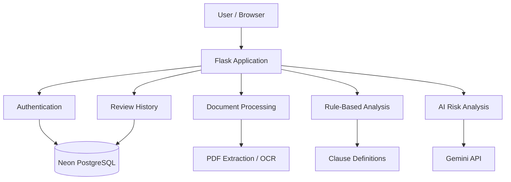

# cleAIra — AI-Powered Legal Document Review

cleAIra is a web-based legal document review application that helps users understand contracts and legal documents through clause-by-clause analysis. It identifies potentially concerning provisions, highlights risks, and organizes findings by priority to help users focus on clauses that may require closer attention.

🔗 **Live Demo:** [cleAIra](https://cleaira.vercel.app/)  
📂 **Repository:** [GitHub](https://github.com/DhritiNarayan/cleAIra)

---

## ✨ Features

### 📄 AI-Assisted Document Analysis
- Analyze legal documents and contractual text.
- Review documents clause by clause.
- Identify potentially concerning terms and provisions.
- Provide structured findings with supporting document context.

### 🚨 Priority-Based Risk Classification
Organizes detected findings into different priority levels:

- **Critical** — Potentially serious issues that require immediate attention.
- **High** — Significant concerns that should be carefully reviewed.
- **Medium** — Provisions that may require clarification or further examination.

### 🔐 Authentication & Account Security
- User registration and login.
- Secure password hashing.
- Email verification workflow.
- Session-based authentication.
- Protected application routes.

### 📚 Review History
- Access previously completed document reviews.
- View detailed results of previous analyses.
- Delete individual reviews.
- Select and delete multiple reviews.

### 👤 Account Management
- Dedicated account page.
- Account-specific settings.
- Password change functionality.
- Secure logout.

### 🌐 Interactive Web Interface
- Server-rendered pages using Flask and Jinja2.
- Responsive, green-themed interface.
- Navigation between Review, History, and Account sections.
- Interactive frontend components using JavaScript.

---

## 🛠️ Tech Stack

| Category | Technologies |
|---|---|
| Backend | Python, Flask |
| Frontend | HTML5, CSS3, JavaScript, Jinja2 |
| Database | Neon PostgreSQL |
| Database Adapter | psycopg |
| AI Integration | Google Gemini API |
| Document Processing | PyMuPDF |
| OCR | Tesseract |
| Authentication | Flask Sessions, Werkzeug Password Hashing |
| Email | SMTP |
| Deployment | Vercel |
| Version Control | Git, GitHub |

---

## 🏗️ Architecture

cleAIra follows a server-rendered Flask architecture with separate modules for authentication, document processing, clause analysis, AI augmentation, and review history.



### Core Components

| Module | Responsibility |
|---|---|
| `app.py` | Main Flask application and request handling |
| `auth.py` | Authentication and user-related functionality |
| `clauses.py` | Clause definitions and rule-based detection |
| `legal_ai_service.py` | Legal document analysis and AI-related processing |
| `gemini_llm_service.py` | Gemini API integration |
| `history.py` | Review storage and history management |
| `utils.py` | Shared utility functions |

The rule-based engine acts as the primary clause detection mechanism. Gemini is used as an additional analysis layer to identify potential risks that may not have been detected by the rule-based system.

---

## 🔄 Application Workflow

### 1. User Authentication

1. The user registers with a username, email, and password.
2. Input validation is performed.
3. Passwords are hashed using Werkzeug before storage.
4. A verification email is sent through SMTP.
5. The user verifies their email and logs in.
6. Flask sessions maintain the authenticated user's state.

### 2. Document Review

1. The authenticated user submits contract text or uploads a document.
2. Supported inputs include PDF and image formats such as PNG, JPG, and JPEG.
3. Uploaded files are limited to 10 MB.
4. PDF text is extracted using PyMuPDF.
5. OCR is used when extracted PDF text is insufficient, and for image-based documents.
6. Extracted content is cleaned and divided into manageable document units.
7. Relevant clause definitions are matched against the document.
8. The rule-based engine identifies provisions and assigns priorities.
9. Gemini performs additional risk analysis to identify potentially overlooked issues.
10. Findings are validated, organized, and presented to the user.
11. The completed review is saved to PostgreSQL for future access.

### 3. Review History

Users can access previously analyzed documents, view detailed results, and manage saved reviews. Review records are associated with the authenticated user.

### 4. Account Management

Users can access account settings, change their password, and log out of their account.

---

## 📂 Project Structure

```text
cleAIra/
│
├── app.py
├── auth.py
├── clauses.py
├── gemini_llm_service.py
├── legal_ai_service.py
├── history.py
├── utils.py
│
├── templates/
│   ├── index.html
│   ├── history.html
│   ├── history_detail.html
│   ├── account.html
│   ├── login.html
│   ├── register.html
│   └── verify_email.html
│
├── static/
│   ├── script.js
│   └── style.css
│
├── requirements.txt
├── test_clause_engine.py
├── test_contract_ai.py
└── README.md
```

---

## 🚀 Getting Started

### Prerequisites

Make sure you have installed:

- Python 3.10 or a compatible version supported by the project dependencies
- pip
- Git

You will also need:

- A PostgreSQL database (Neon is used for the deployed project)
- A Gemini API key
- SMTP credentials for email verification

### 1. Clone the repository

```bash
git clone https://github.com/DhritiNarayan/cleAIra.git
cd cleAIra
```

### 2. Create a virtual environment

```bash
python -m venv venv
```

**Windows PowerShell:**

```powershell
venv\Scripts\Activate.ps1
```

**Windows Command Prompt:**

```bat
venv\Scripts\activate
```

**macOS / Linux:**

```bash
source venv/bin/activate
```

### 3. Install dependencies

```bash
pip install -r requirements.txt
```

### 4. Configure environment variables

Create a `.env` file in the root directory and configure the following variables:

```env
CLEAIRA_SECRET_KEY=your-secret-key
CLEAIRA_BASE_URL=http://127.0.0.1:5000

DATABASE_URL=your-postgresql-connection-string

GEMINI_API_KEY=your-gemini-api-key
GEMINI_MODEL=your-gemini-model

CLEAIRA_EMAIL_HOST=smtp.gmail.com
CLEAIRA_EMAIL_PORT=465
CLEAIRA_EMAIL_USERNAME=your-email
CLEAIRA_EMAIL_PASSWORD=your-email-password
```

Replace the values with your actual credentials and configuration.

> **Security:** Never commit your `.env` file, database credentials, email passwords, API keys, or production secret keys to GitHub.

### 5. Run the application

```bash
python app.py
```

Open the local address in your browser:

```text
http://127.0.0.1:5000
```

---

## 🗄️ Database

cleAIra uses **PostgreSQL** hosted through Neon for persistent application data.

The database stores information required for user authentication and review history. Database configuration is supplied through environment variables, allowing separate configurations for local development and deployment.

---

## 🔒 Security Considerations

The application incorporates security-oriented practices such as:

- Password hashing instead of storing plaintext passwords.
- Session-based authentication.
- Email verification during registration.
- Authentication checks on protected routes.
- User-scoped review access.
- Parameterized database operations.
- Environment-based secret configuration.
- Removal of uploaded files after document text extraction.

Users should avoid uploading documents containing sensitive information unless they understand the application's data handling and deployment configuration.

---

## ⚠️ Limitations

- Automated analysis may miss important legal issues.
- Clause interpretation may depend on context, jurisdiction, and document wording.
- AI-generated findings may be incomplete or inaccurate.
- The analysis should not be treated as a substitute for professional legal review.

---

## 🔮 Future Improvements

- Downloadable document review reports.
- Advanced search and filtering for review history.
- Document comparison.
- More detailed explanations for flagged clauses.
- Improved automated test coverage.
- Enhanced document-processing error handling.
- Additional document formats and processing capabilities.
- Better feedback regarding the reliability of generated findings.

---

## ⚖️ Disclaimer

cleAIra is designed to assist users in understanding legal documents and identifying provisions that may require attention. It does not constitute legal advice and does not replace consultation with a qualified lawyer.

Users should independently verify all findings before relying on them for legal, financial, or contractual decisions.

---

## 👨‍💻 Author

**Dhriti Narayan**

[GitHub Profile](https://github.com/DhritiNarayan)

---

<p align="center">
  Built with Python, Flask, PostgreSQL, and AI.
</p>
